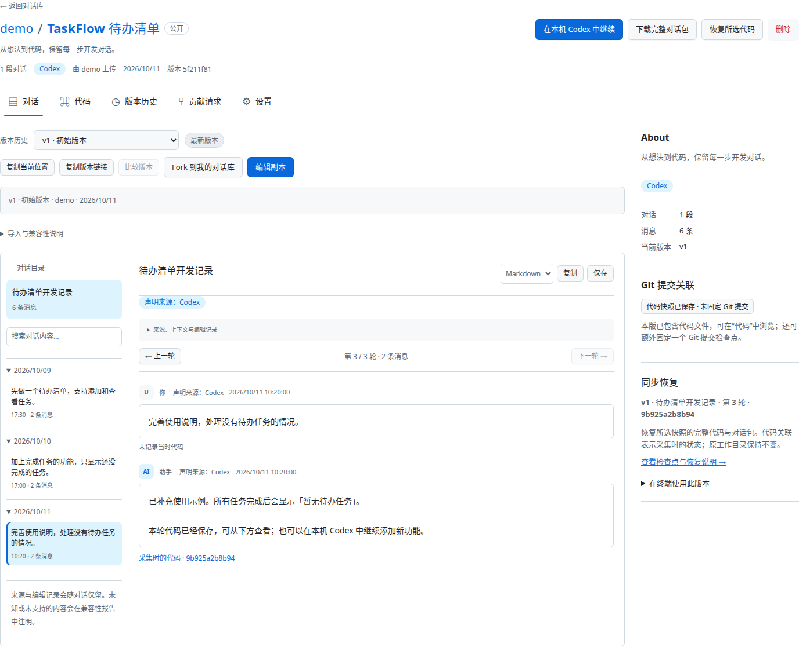
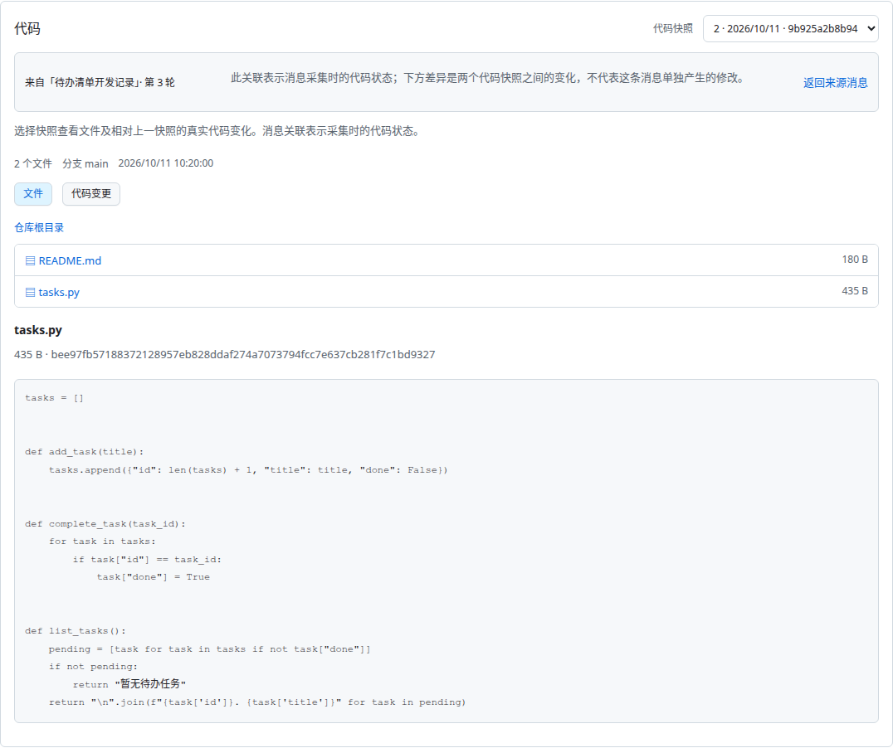
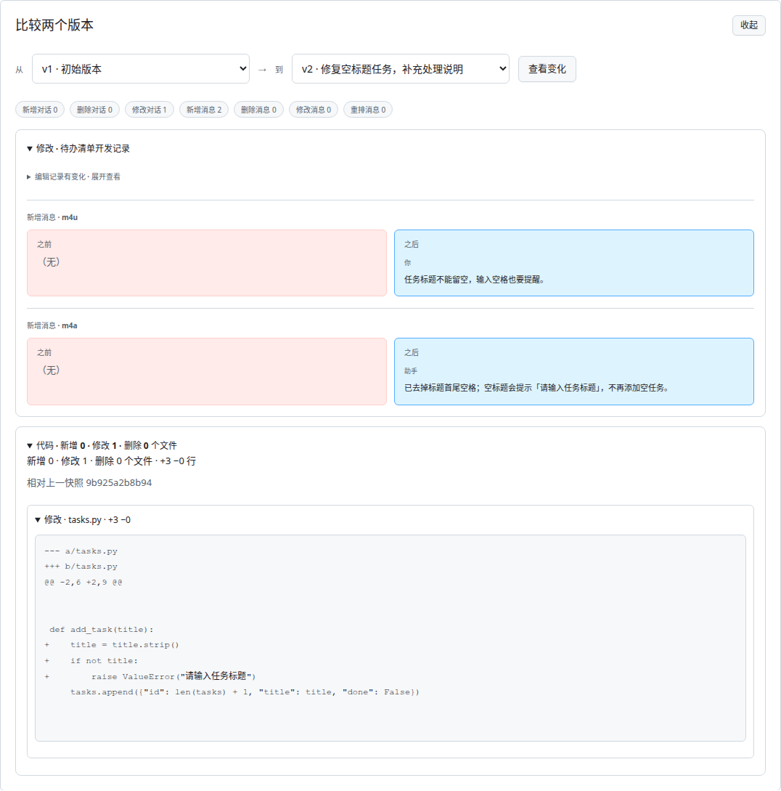
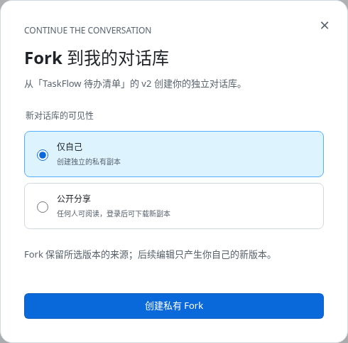
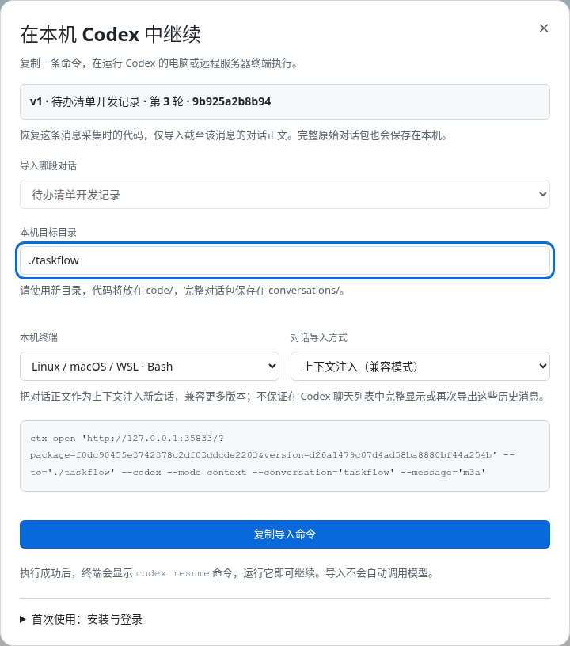
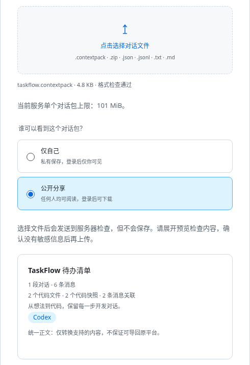

# ContextHub

**把 AI 对话和当时的代码一起保存，下次接着开发。**

写完一个功能，用 ContextHub 保存这段开发对话和当前代码。以后可以回看为什么这样写、恢复保存过的版本，也可以分享给别人，让对方在自己的 Codex 里继续。

网页用来整理、阅读和分享；配套终端工具 **`ctx`** 用来保存和同步。你仍然可以照常使用 Git。

[打开网站](https://contexthub.reflectstars.dev/) · [安装 ctx](https://contexthub.reflectstars.dev/cli) · [完整命令说明](docs/cli.md)

## 先看看界面

对话按日期和轮次整理，不用在一整页聊天记录里来回翻。



截图使用演示项目，展示的是实际运行的界面。

## 1. 安装工具

需要 **Python 3.12+** 和 **Git**。要读取或导入本机 Codex 对话，还需要安装 **Codex CLI**。

<details>
<summary>Linux / 远程服务器：展开安装命令</summary>

```bash
mkdir -p ~/.local/bin
curl -fS https://contexthub.reflectstars.dev/ctx.pyz -o ctx.pyz
curl -fS https://contexthub.reflectstars.dev/ctx.pyz.sha256 -o ctx.pyz.sha256
sha256sum -c ctx.pyz.sha256 && install -m 755 ctx.pyz ~/.local/bin/ctx
export PATH="$HOME/.local/bin:$PATH"
ctx --version
```

把上面的 `export PATH=...` 一行加入 `~/.bashrc`，新终端也能使用 `ctx`。升级时重新下载、校验并安装即可。

</details>

Windows 用户按[安装页面](https://contexthub.reflectstars.dev/cli#windows)操作，无需 WSL；目前仍为预览版。

接着在[网站](https://contexthub.reflectstars.dev/)注册账号。网页登录和终端登录各自保存，终端只需先登录一次：

```bash
ctx auth login --username 你的用户名
```

## 2. 第一次保存项目

在项目的 **Git 根目录**打开终端：

```bash
ctx init --title "我的项目"        # 初始化一次即可
ctx add --codex                    # 读取 Codex 对话，连同当前代码一起暂存
ctx diff --staged                  # 检查这次要保存的内容
ctx commit -m "保存第一版"         # 保存到本地
ctx push                          # 上传到网站，默认私有
ctx remote                        # 查看项目的网页链接
```

代码中还没执行 `git commit` 的修改也会保存。只有 `add` 会采集新内容，`commit` 和 `push` 使用已经暂存、提交的内容。

如果检测到多段 Codex 对话，先运行 `ctx codex list`，再用 `ctx add --codex --thread 会话ID` 选择要保存的那一段。

`ctx` 会生成自己的管理文件，建议[按指南加入 `.gitignore`](docs/cli.md#直接跟踪-codex-对话)。上传前检查内容，避免把密码或不想分享的对话传上去。

## 3. 以后这样保存

继续开发后，在同一个目录执行：

```bash
ctx add .
ctx diff --staged
ctx commit -m "完成任务筛选功能"
ctx push
```

`ctx add .` 会更新已绑定的 Codex 对话和当前代码。登录、初始化和选择会话不用每次重复；也可以先离线保存，联网后再上传。

## 4. 在网页回看、分享

打开项目后，可以按日期找对话、浏览代码、比较版本，或复制链接分享当前轮次和代码文件。

点击消息下的 **“采集时的代码”**，就能看到关联的代码快照，再返回来源消息。



- **公开项目**：任何人可以阅读；下载、上传和 Fork 等操作需要登录。
- **私有项目**：只有所有者可以查看。新项目默认私有，可在设置中修改。
- **复用别人的项目**：点击 Fork，保存到自己的账户后继续修改。

只能恢复已经保存过的代码；没有关联记录的旧消息会显示“未记录当时代码”。关联记录的是保存时的代码，不代表这条消息单独改了哪些文件。

想知道前后改了什么，选择两个版本，查看对话和代码的差异。



想保留一份自己的副本，点击 Fork，再选择公开或私有。



## 5. 带到自己的 Codex 继续

1. 在网页选中对话轮次或代码快照，点击 **“在本机 Codex 中继续”**。
2. 填一个尚不存在的本机目录，选择 Bash 或 PowerShell，点击“复制导入命令”。
3. 到**运行 Codex 的电脑或服务器终端**粘贴执行。
4. 完成后，终端会显示 `codex resume` 命令，运行它即可继续。



生成的 `ctx open` 命令会下载选定版本、恢复代码并创建新的 Codex 会话。文件会放在目标目录的 `code/`，完整对话包保存在 `conversations/`，不覆盖原项目。

首次需在终端登录，并更新到支持 `ctx open` 的工具版本，可用 `ctx open --help` 检查。当前轮次没关联代码时，可先到“代码”标签选择已保存快照。

默认是**上下文注入**，不保证在 Codex 中完整显示历史聊天。需要重建文本时间线时可切换模式，目前仅支持 Codex 0.153.4。[详细说明](docs/cli.md#从网页一步导入本机-codex)

## 已经有导出的对话？

直接在网页点击 **“上传对话包”**，选择文件，预览后保存。支持 `.contextpack`，也支持 Codex、ChatGPT、Claude、DeepSeek 的部分导出格式；具体格式见[导入指南](docs/import-formats.md)。



也可以在已初始化的项目中用终端导入：

```bash
ctx add ./claude-export.json --platform claude
ctx diff --staged
ctx commit -m "加入之前的讨论"
ctx push
```

需要离线传给别人，用 `ctx export ../project.contextpack` 导出已提交的版本。只有对话、没有代码的包，也可以存储和分享；导入 Codex 时需要[指定已有项目目录](docs/cli.md#codex-导出与导入)。

## 自己运行网站

安装 Python 3.12+ 和 Git 后：

```bash
git clone https://github.com/reflectstars111/ContextHub.git
cd ContextHub
python3 -m contexthub serve --port 8765
```

打开 <http://127.0.0.1:8765> 即可使用，数据默认保存在 `.context-data/`。网站本身不运行模型，也不需要 GPU。

## 更多说明

- [终端命令](docs/cli.md)：分支、合并、恢复、与普通 Git 交换。
- [网页操作](docs/web-guide.md)：编辑、版本历史、Fork 和贡献请求。
- [本地部署](docs/deployment/local.md) / [公网部署](docs/deployment/public-cloudflare.md)：常驻运行、备份与升级。
- [参与开发](CONTRIBUTING.md) · [截图复现](docs/images/README.md)

项目源码采用 [MIT 许可证](LICENSE)。上传内容的许可由原作者决定。
